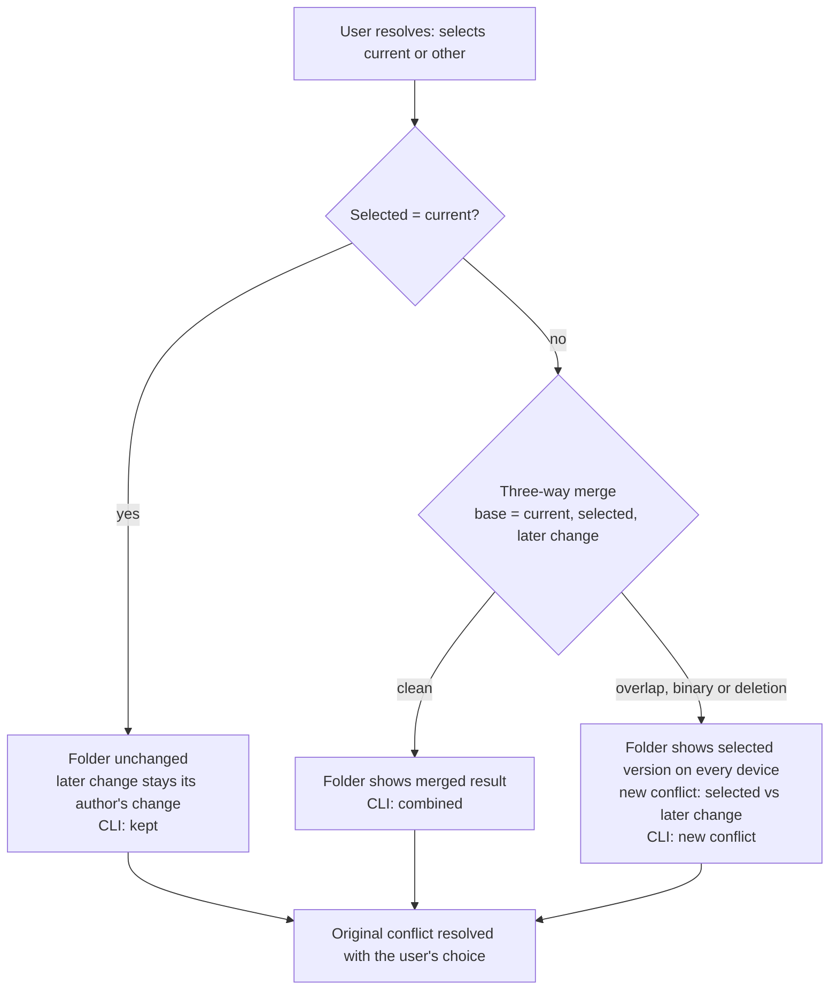

# Resolving conflicts after later edits

This page explains how Dispatch Mesh resolves a conflict when the file changed again after the conflict was recorded. It describes the behavior decided in refinement of [[Story - US00010 - Resolve a conflict after the file was edited again|US00010]] on 2026-11-09. **US00010 is not implemented yet.** Each section says whether it describes today's engine (checked at `c48141b`) or the planned behavior. Where this page and the ticket disagree, the ticket wins.

## Terms

| Term | Meaning |
|---|---|
| **Current version** | The version shown in the folder when the conflict was recorded (`Conflict.accepted`). |
| **Other version** | The competing version kept aside (`Conflict.incoming`). |
| **Selected version** | The version the user chooses when resolving: current or other. A resolution always selects exactly one recorded version (ADR-0003). |
| **Later change** | Any save to the conflicted path after the conflict was recorded: a local edit, or a change received from another device. |
| **Recorded input** | A session's change that the conflict record points at, identified by its fingerprint in `accepted_sessions` or by `Conflict.session`. |

## Today: resolving is refused

`Workspace::resolve` (`src/engine.rs` ~1536) captures pending saves and then requires the folder to still hold the current version (~1549). Any later change, local or received, makes **both** choices fail with "File has newer edits; review them before resolving this conflict". While the conflict is open, `publish_ready` skips every session that contains the path, so the contributors' sessions, including their other files, stay unpublished.

The only way out is by hand: copy the later text aside, restore the file to the current version byte for byte, resolve, then re-apply the later text.

## Planned: the rule

Resolving always succeeds. The later change is treated as a change on top of the current version and is three-way merged onto the selected version:

| Merge input | Value |
|---|---|
| Base | the current version |
| One side | the selected version |
| Other side | the later change |

Most of this already exists. `render()` rebuilds the folder from `main` plus every unsettled session. A later change that is its own change (base = current version) is merged onto the selected version by `merge_change`, which records a new conflict on overlap. US00010 removes the guard, keeps later edits separate from recorded inputs (see [Session split](#session-split-at-capture)), and adds the CLI wording.

The reconciliation is built as "resolved content plus a later change", not "selected input plus a later change". That way [[Story - US00004 - AI-proposed text conflict merges with human approval|US00004]] can reuse it with an approved composed text as the resolved content.

## Examples

All examples use `trip.md`, shared by Alice and Bob:

| | Content |
|---|---|
| Base | `Meet at 10:00 at the station.` |
| Alice (10:05) | `Meet at 9:30 at the station.` |
| Bob (10:07) | `Meet at 10:00 at the main entrance.` |

At 10:10 Mesh records conflict **C1**. The current version is Alice's line and the other version is Bob's.

### 1. Non-overlapping later edit, other version chosen: combined

At 11:20 Alice adds a second line, `Bring tickets.` At 11:25 she chooses Bob's version.

| Merge | Content |
|---|---|
| Base (current) | `Meet at 9:30 at the station.` |
| Selected (Bob) | `Meet at 10:00 at the main entrance.` |
| Later change (Alice) | `Meet at 9:30 at the station.` + `Bring tickets.` |
| **Result** | `Meet at 10:00 at the main entrance.` + `Bring tickets.` |

C1 is resolved with Bob's version. `Bring tickets.` stays Alice's own change and publishes after the resolution under her name. CLI: the later edit was combined.

### 2. Any later edit, current version kept: no-op

Same 11:20 edit, but Alice keeps her own version. The base equals the selected version, so the later change applies unchanged. The folder doesn't change, C1 is resolved with Alice's version, and both lines publish as hers. CLI: the later edit was kept.

### 3. Overlapping later edit, other version chosen: new conflict

At 11:20 Alice changes the same line again, to `Meet at 9:15 at the station.` At 11:25 she chooses Bob's version. Both sides changed the line, so the merge overlaps.

| | Every device |
|---|---|
| `trip.md` | `Meet at 10:00 at the main entrance.` |
| C1 | resolved, Bob's version selected |
| New conflict C2 | current: Bob's line (Bob) · other: `Meet at 9:15 at the station.` (Alice, 11:20) |

The selected version shows because every device renders the same folder. Showing the later edit instead would put text in front of Bob that Alice didn't choose, replacing the very line she chose. Alice's 9:15 line leaves her open file but is kept in C2 and in her session. Nothing on `trip.md` publishes until C2 is resolved. CLI: the later edit overlapped and was kept as a new conflict.

### 4. Binary files

`logo.png` is in conflict. Alice saves a new image at 11:20 and chooses Bob's image. Binary content is never merged (ADR-0003), so this gives a new whole-file conflict: the folder shows Bob's image, and Alice's 11:20 image is the other side, retrievable byte for byte. If she keeps her own image instead, it's a no-op, as in example 2.

### 5. Deletions

| Situation | Result |
|---|---|
| Alice **deletes** `trip.md` at 11:20 and chooses Bob's version | New conflict. The folder shows Bob's file; "deleted" (Alice) is the other side. |
| Bob's version **is** a deletion; Alice edited at 11:20 and chooses Bob's | New conflict. The file **disappears** from the folder; Alice's 11:20 text is the other side. The CLI says that the chosen version deletes the file and the later edit was kept as a new conflict. |
| Both the selected version and the later change are deletions | Clean. The file stays deleted, no conflict. |

These follow `git.merge` (`src/git.rs` ~398). When neither side equals the base, a binary file or a deletion always conflicts.

### 6. Change received from another device

At 11:15 Bob adds `Bring snacks.` to `trip.md`. It syncs to Alice. Today Alice can't resolve C1, although she never touched the file again. In the planned behavior, Bob's session is another device's session and therefore already a separate change. After Alice's choice it is merged in exactly like examples 1–5. The CLI names the author: "Bob's 11:15 edit was combined".

## Session split at capture

A later edit must stay **separate** from the recorded input. Otherwise `capture` folds it into that input (`git.merge` at `src/engine.rs` ~540), the fingerprint changes, and `matching_resolution` stops recognising the input. The next `render()` then records a second conflict, and the original one can never be resolved.

**Planned rule:** when a save touches a path with an unresolved conflict whose current or other input belongs to the device's open session, Mesh closes that session first and captures the save into a new session. This is the mechanism `finish` already uses. Every device applies the rule to its own saves.

**Example:** Alice's open session S1 holds `trip.md` (9:30, her recorded input) and an edit to `notes.md`. At 11:20 she adds `Bring tickets.` to `trip.md`.

| Session | Contents |
|---|---|
| S1 (closed at 11:20) | `trip.md` 9:30 · `notes.md`. Unchanged, so the recorded input stays byte-exact. |
| S2 (new) | `trip.md`: only the `Bring tickets.` delta, with the 9:30 version as its base |

If Alice chooses Bob's version, `main` receives three commits in this order:

1. S1 with only `notes.md`. Its `trip.md` input was rejected by the resolution.
2. Bob's session with his line.
3. S2 with `Bring tickets.`, attributed to Alice.

No commit is empty and none repeats content.

The cost: Alice's work lands in two commits, and the split happens even if the conflict is never resolved.

## Compatibility

There is **no format change**. `Resolution` and `Conflict` records are unchanged, split sessions are ordinary sessions, and the manifest stays `version: 2`.

In a workspace with mixed versions, an older client renders the same folder from the same records. For its own user's later edits it keeps today's behavior until it is upgraded: the refusal, and folding during capture. No data is lost.

## Out of scope

- Repairing workspaces that folded a later edit into a recorded input before US00010.
- Writing a combined version by hand, and AI-proposed merges ([[Story - US00004 - AI-proposed text conflict merges with human approval|US00004]]).
- Conflict UI wording in the status window ([[Story - US00006 - Conflict list and resolution in the status window|US00006]]).

## Related

[[Story - US00010 - Resolve a conflict after the file was edited again|US00010]] · [[ADR-0003 — Preserve synchronized conflict inputs and traceable resolutions]] · [[Device branch format]] · [[Story - US00006 - Conflict list and resolution in the status window|US00006]] · [[Story - US00004 - AI-proposed text conflict merges with human approval|US00004]]
