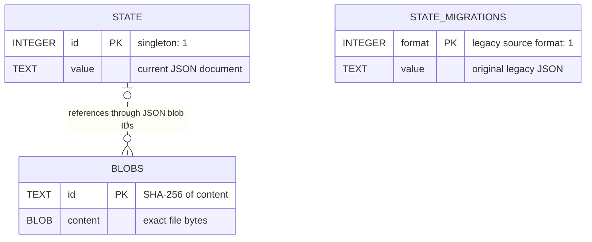

# SQLite database format

Implementation reference for the 0.2.5 engine at revision `29d3d58`, checked on 2026-11-06. Each initialized workspace owns **`.mesh/state.sqlite`**. It holds local synchronization state and recoverable file content. It is not uploaded as a database: the remote representation is described in [[Device branch format]].

The database has three application tables. Most domain records live inside one JSON state document; there are no separate SQL tables for sessions, paths, authors, conflicts, or intents.

## Physical schema

The following is the schema from `storage::initialize`:

```sql
PRAGMA journal_mode=WAL;
PRAGMA synchronous=FULL;

CREATE TABLE IF NOT EXISTS state (
    id INTEGER PRIMARY KEY CHECK(id=1),
    value TEXT NOT NULL
);

CREATE TABLE IF NOT EXISTS blobs (
    id TEXT PRIMARY KEY,
    content BLOB NOT NULL
);

CREATE TABLE IF NOT EXISTS state_migrations (
    format INTEGER PRIMARY KEY,
    value TEXT NOT NULL
);
```

These are ordinary SQLite tables, not `STRICT` tables. The DDL has no foreign keys, JSON validity checks, hash checks, triggers, or additional application-created indexes. Primary keys supply key uniqueness; the Rust loader validates the serialized format and referenced content. Application expectations below are stronger than the SQL declarations alone.

### `state` — current durable state

| Column | SQL declaration | Application values and purpose |
|---|---|---|
| `id` | `INTEGER PRIMARY KEY CHECK(id=1)` | Singleton key `1`. At most one row; initialization/save creates it. It is not a session or workspace ID. |
| `value` | `TEXT NOT NULL` | Compact serialized JSON containing the complete current state and references to file bytes. The row is replaced on save when its serialized value changes. |

This is the latest state, not a row-per-save history. A normal initialized workspace has exactly one row. Older state documents are not automatically archived on every save.

### `blobs` — content-addressed file bytes

| Column | SQL declaration | Application values and purpose |
|---|---|---|
| `id` | `TEXT PRIMARY KEY` | Lowercase 64-character SHA-256 hex digest of `content`, generated by `model::digest`. |
| `content` | `BLOB NOT NULL` | Exact bytes of a file version, including binary data or a zero-byte file. |

The writer uses `INSERT OR IGNORE`, so identical bytes share one row across paths, sessions, conflict inputs, and recovery snapshots. The key is based on content alone; it contains no path or timestamp.

On load, each referenced ID must be 64 ASCII hexadecimal characters, resolve to a row, and equal the SHA-256 digest recomputed from its content. Missing or corrupt referenced blobs cause an error rather than silent replacement. Loading checks referenced blobs, not every accumulated unreferenced row.

### `state_migrations` — original legacy state

| Column | SQL declaration | Application values and purpose |
|---|---|---|
| `format` | `INTEGER PRIMARY KEY` | Source format being backed up. The current migration writes `1`. This is not a migration sequence number or the current schema version. |
| `value` | `TEXT NOT NULL` | Exact original legacy JSON string from `state.value`, retained before the first conversion to the reference-based format. |

Fresh format-two workspaces normally have no rows here. Migrated workspaces retain the format-one backup. `INSERT OR IGNORE` preserves an existing backup for the same format. This table is not a general audit log or an automatically used rollback mechanism.

## Relationships

This ER diagram shows the **logical application relationship**. The relationship line is not a declared SQL foreign key: references are nested JSON properties inside `state.value`, and the same blob can occur many times within that document. Blobs can also remain after nothing in the current state references them. The migration backup is independent.



## Inside `state.value`

New writes use this wrapper:

```json
{
  "format": 2,
  "state": {
    "main": "<Git commit ID>",
    "observed": {
      "notes/example.md": { "blob": "<64-character SHA-256 digest>" }
    },
    "manifest": {
      "version": 1,
      "sessions": {},
      "resolutions": {},
      "conflicts": {}
    },
    "conflicts": {},
    "intent": null,
    "applying": null,
    "attention": null,
    "remote_main": null,
    "pending_capture": null,
    "apply_backups": {},
    "uploaded": {},
    "offline": null,
    "summary_failure": null
  }
}
```

This is an illustrative shape; placeholders are not valid stored hashes. `format: 2` selects the local storage encoding. It is independent of `manifest.version`, remote `state.json` version, configuration version, and application version. The engine initializes the local manifest with `version: 1` and explicitly writes remote snapshots with `version: 2`; the nested local number does not mean its stored bytes use the old integer-array encoding.

### State properties

| JSON property under `state` | Values / structure | Purpose |
|---|---|---|
| `main` | Git commit ID string. | Current integrated permanent-history base in `.mesh/objects.git`. The name remains `main` even when the configured shared branch has another name. |
| `observed` | Object: relative path → local blob reference. | Last installed/capture baseline used to distinguish new local edits from incoming content. Not necessarily the current filesystem while a user is editing. |
| `manifest` | Object with `version`, `sessions`, `resolutions`, `conflicts`. | Locally known session metadata and selections, including sessions fetched from peers. Own-device sessions are filtered when creating the remote manifest. |
| `conflicts` | Object: conflict ID → conflict record. | Engine's retained local conflict records, including locally detected and received conflicts. This collection is used for conflict queries and copied into outgoing manifests. It is distinct from `manifest.conflicts`; do not assume the two maps mirror each other. |
| `intent` | Intent object or `null`. | Currently active local intent scope: `id`, `purpose`, exact `paths`, and `created_at`. Historical associated intents are retained in session records. |
| `applying` | Object: relative path → local blob reference, or `null`. | Desired complete file view for an incoming apply operation, saved before modifying working files. Non-null means apply recovery is pending; `{}` means the intended view has no files. |
| `attention` | String or `null`. | Persisted explanation for a synchronization/recovery condition requiring attention. Not the computed workspace status enum. |
| `remote_main` | Git commit ID string or `null`. | Last recorded shared-branch position; supports detection of external history rewriting or deletion. Null means none recorded yet. |
| `pending_capture` | Object: relative path → local blob reference, or `null`. | Saved file view whose local edits cannot yet be attributed safely because of received draft dependencies. Null means none pending; an empty object is still a pending view. |
| `apply_backups` | Object: relative path → recovery UUID string. | Tracks displaced-file backups during apply/recovery. The UUID names `.mesh/recovery/<id>/`, not a row in `blobs`. Cleared on completed apply; backup files remain. |
| `uploaded` | Object: own session UUID → unsigned revision integer. | Last own revisions known to have reached the remote device branch. Used to distinguish saved locally from uploaded drafts. Settled entries are removed when uploads are recorded. This map is never included in remote manifests. |
| `offline` | String or `null`. | Recorded cause of an unreachable remote; local capture can continue. |
| `summary_failure` | String or `null`. | Last summary failure, sanitized of credentials and provider response bodies; supports attention status while factual fallback publication remains possible. |

For compatibility, absent `remote_main`, `pending_capture`, `offline`, and `summary_failure` default to `null`; absent `apply_backups` and `uploaded` default to empty objects. `manifest.conflicts` also defaults to an empty object. New serialization emits these properties explicitly.

### Nested domain records and content references

The session, change, identity, intent, message, conflict, and resolution property structures are described in the field tables in [[Device branch format]]. They use the same Rust model locally. The important local differences are:

- A non-null `{ "blob": "..." }` refers to **`blobs.id` in SQLite**, using SHA-256. A remote blob reference instead names a Git blob in a device snapshot. They are different identifiers and stores even when the file bytes are identical.
- Local `manifest.sessions` can contain both own and received sessions; an outgoing device manifest includes only own sessions.
- The active `state.intent`, recovery fields, upload bookkeeping, and diagnostic fields are local-only. They are not extra properties of remote `state.json`.

The codec stores bytes as references at these locations:

| Location | Referenced file versions |
|---|---|
| `observed[path]` | Capture baseline bytes. |
| `applying[path]`, `pending_capture[path]` | Apply target or pending-capture bytes, when the containing map is non-null. |
| `manifest.sessions[id].changes[path].base` / `.content` | Before and after versions for a session path. |
| `manifest.conflicts[id].base` / `.accepted` / `.incoming` | Conflict inputs carried in the manifest object. |
| `conflicts[id].base` / `.accepted` / `.incoming` | Engine's retained conflict inputs. |
| `manifest.resolutions[id].selected` | Selected resolution bytes. |

Optional file versions use JSON `null` for absence/deletion. File-view maps (`observed`, `applying`, `pending_capture`) instead omit paths that do not exist; their present values are always references. A zero-byte file always has a blob row with zero-length content and a non-null reference. There is no special SQL row for deletion.

## Save, read, and recovery behavior

`storage::save` runs one SQLite transaction: it inserts all referenced byte buffers into `blobs`, creates the legacy backup if needed, and upserts the current state row. It commits these together, so a failed transaction does not leave the new state pointing to only partly inserted content. An unchanged serialized state is not rewritten. File bytes are not embedded as integer arrays in new JSON.

`storage::load` reads the singleton state JSON, checks the local format, resolves its references, and verifies their hashes. A per-load cache avoids retrieving and hashing identical referenced content repeatedly. The ordinary workspace open takes the Mesh operation lock, loads state, recovers a pending apply, and saves; status inspection opens the database read-only without taking that operation lock or running migration/recovery writes.

SQLite WAL journaling and Mesh's `applying` journal serve different purposes. WAL protects database transactions. `applying` records work spanning SQLite and the filesystem: Mesh persists the intended view before file changes, preserves displaced files under `.mesh/recovery/`, and can resume after interruption. Database commit does not make a multi-file filesystem update one atomic operation. Capture refuses to proceed while apply recovery remains pending. On successful apply, `applying` becomes null and `apply_backups` is cleared; files already stored in the recovery directories are retained.

WAL mode can produce adjacent `state.sqlite-wal` and `state.sqlite-shm` files while SQLite is in use. These are SQLite support files, not additional application tables or synchronized content. A live database file copy alone is not a complete backup strategy: committed changes may still be in its WAL, and the workspace also depends on Git objects, configuration, and external recovery files.

## Migration and retention

A legacy local state document has no top-level `format` property and embeds file bytes in JSON. The loader can still read it. The next locked save (including normal workspace open) stores its exact original JSON in `state_migrations` under `format=1`, writes content-addressed blob rows, and replaces the current row with the format-two wrapper, all in one transaction. Read-only inspection does not migrate it. An explicit unsupported wrapper format is rejected.

There is no automatic blob pruning, state-backup expiry, or recovery-directory cleanup in this preview. The current state row is replaced over time, but older distinct byte buffers remain in `blobs` even if no current reference uses them. Consequently, the database is not a complete chronological event log, and retained blobs alone do not identify which path or save originally used them. Session and conflict records provide retained context; uploaded snapshot history also exists separately in Git.

`.mesh/config.json` stores workspace/device/provider configuration; `.mesh/objects.git` stores Git objects and refs; `.mesh/recovery/<id>/content` and `record.json` store displaced files and their original paths. They are outside SQLite. Do not delete `.mesh`, edit state JSON, or remove blob rows as a repair or cleanup shortcut: the database can contain the only copies of unpublished edits and conflict inputs.

## Sources and maintenance register

Checked against `src/storage.rs` (exact DDL, load/save, migration, integrity validation), `src/codec.rs` (every mapped content field), `src/model.rs` (JSON properties/defaults), `src/engine.rs` (database opening, inspection, apply journal and recovery), and `tests/storage_transport.rs` (existing assertions for deduplication, recovery fields, atomic migration and rollback). Documentation-only verification; no runtime, remote, or platform tests were run for this page.

Maintenance owner: [[Kai]]. Refresh registered here and in [[index]] on schema, serialization, migration, or recovery changes and before use with a newer release; no recurring automation configured. Related: [[Device branch format]], [[ADR-0007 — Persist state transactionally with recovery journals]], and [[ADR-0008 — Store content as blobs referenced by metadata]].
